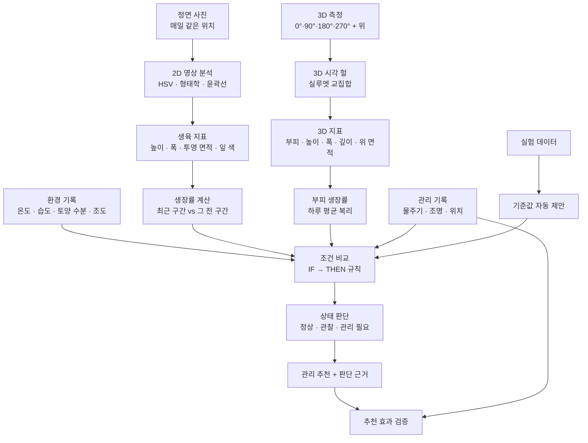

# 자람 알고리즘 명세서

컴퓨터 비전 기반 식물 생육 분석 및 맞춤형 관리 추천 시스템 (2026 과학과제연구 · 바티칸 시국)

이 문서는 앱이 사진에서 생육 지표를 뽑고, 생장률을 계산하고, 관리 행동을 추천하는 모든 단계를 **코드와 같은 수치**로 정리한 것입니다. 숫자는 `thresholds.py`의 초기값이며, 실제 값은 앱의 [설정 › 추천 기준]에서 바꿀 수 있습니다.

---

## 1. 전체 흐름



---

## 2. 2D 영상 분석 (`vision.py`)

| 단계 | 처리 | 값 |
|---|---|---|
| 1 | 사진 불러오기, 휴대폰 회전 정보(EXIF) 반영 | Pillow `exif_transpose` |
| 2 | 크기 맞추기: 긴 변을 같은 길이로 | 1280 px (같은 위치에서 찍으면 1 px = 같은 실제 길이) |
| 3 | 노이즈 제거 | Gaussian blur 5×5 |
| 4 | BGR → HSV 변환 후 초록색 범위만 남기기 | 종류별 HSV 범위 (아래 표) |
| 5 | 형태학 연산 | 타원 커널 5×5, Opening(잡음 제거) → Closing(잎 사이 빈틈 메우기) |
| 6 | 윤곽선 검출 후 식물 영역 고르기 | 아래 '식물 영역 선택' |
| 7 | 지표 계산 | 높이·폭 = 경계 상자, 투영 면적 = 식물 픽셀 수, 잎 색 = 식물 영역 평균 Hue |

**식물 영역 선택**

1. 면적이 사진의 0.05%보다 작은 조각은 버립니다.
2. 중심 덩어리를 고릅니다.
   - 정면 사진은 가장 큰 덩어리를 고릅니다.
   - 3D 측면 사진은 화면 가운데에 가장 가까운 덩어리를 고릅니다. 이때 가장 큰 덩어리의 10% 이상인 것만 후보로 보고, 좌우 가장자리에 걸친 덩어리(옆 화분)는 다른 후보가 있으면 뺍니다.
3. 중심 덩어리가 사진의 0.3%보다 작으면 "식물을 찾지 못함"으로 처리합니다.
4. 떨어져 보이는 잎 조각을 합칩니다. 선택된 영역의 경계 상자를 긴 변의 25%만큼 넓히고, 그 안에 걸치는 조각을 반복해서 같은 식물로 묶습니다.
5. 묶은 윤곽선 안에서 실제로 초록색인 픽셀만 투영 면적으로 셉니다. 잎 사이 구멍은 면적에서 빠집니다.

**촬영 품질 경고** (계획서 '영상 분석 오차' 대응)

- 식물이 사진(또는 분석 영역) 가장자리 3 px 안에 닿음 → 잘렸을 수 있음
- 사진 전체 평균 명도 V < 70 → 어두움
- 라플라시안 분산 < 30 → 흐릿함
- 식물 면적 > 사진의 60% → 배경에 초록 물건이 섞였을 수 있음

### 2-1. 분석 영역 지정 (ROI)

- 식물마다 사각형 영역 `[x0, y0, x1, y1]`을 정할 수 있습니다. 좌표는 사진 크기에 대한 0–1 비율입니다.
- HSV 마스크에서 영역 밖은 0으로 만든 뒤 같은 선택 규칙을 적용합니다. 그래서 옆 화분 잎이나 초록 소품이 빠집니다.
- 영역의 한 변이 20 px보다 작으면 무시합니다. 영역을 바꾸면 그 식물의 모든 사진을 다시 분석할 수 있습니다.
- 3D 측정에서는 각도별 사진마다 따로 영역을 지정할 수 있습니다.

### 2-2. 크기 환산 (자 보정)

정면 사진 속 자 위의 두 점과 실제 길이를 입력하면 다음처럼 환산합니다.

```
cm_per_px = 실제 길이(cm) / 두 점 사이 픽셀 거리
높이·폭(cm) = px × cm_per_px
투영 면적(cm²) = px × cm_per_px²
부피(cm³) = px³ × cm_per_px³
```

- 보정 전에는 픽셀 단위로 기록합니다.
- 상대 변화(%)와 생장률(%/일)은 단위와 관계없으므로 보정 전후에 같습니다.

---

## 3. 3D 분석: 시각 헐 (`vision3d.py`)

### 3-1. 원리

식물을 둘러싼 3차원 격자(복셀)를 만듭니다. 각 사진의 식물 실루엣을 그 방향으로 투영해, **모든 사진에서 식물 안쪽인 칸만 남깁니다**. 이를 공간 조각(space carving)이라고 합니다. 남은 칸의 부피가 3D 부피 추정값입니다.

각도 θ에서 찍은 측면 사진에 대해, 격자 칸 (x, y, z)는 다음 위치에 투영됩니다(직교 투영 근사).

```
사진 열 = u_θ + d_θ + x·cos θ + z·sin θ
사진 행 = y
```

- `u_θ`: 사진 속 회전축 위치
- `d_θ`: 회전축 보정값

이 위치가 실루엣 안쪽인 칸만 남깁니다.

```
부피 = 남은 칸 수 × (칸 한 변)³
```

- 격자는 긴 변 96칸입니다. 정렬 탐색에는 40칸 격자를 씁니다.
- 높이·폭(좌우)·깊이(앞뒤)는 남은 칸의 범위입니다. 위에서 본 면적은 위에서 내려다본 칸 수 × (칸 한 변)²입니다.

### 3-2. 촬영 방법과 가정

- **0°(정면)**: 평소 고정 위치에서 자와 함께 찍습니다. 이 사진의 픽셀 크기가 기준이고, 자 보정값으로 cm로 환산합니다.
- **90°·180°·270°**: 같은 방향으로 ¼바퀴씩 돌며, 손으로 들고 비슷한 높이에서 찍습니다.
- **위(선택)**: 정면 쪽이 사진 아래에 오게 내려다보며 찍습니다.
- 최소 조건은 0°와, 그와 수직인 방향(90° 또는 270°) 사진입니다.

### 3-3. 손촬영 보정

1. **높이 맞추기.** 수직축으로 돌려 봐도 식물의 맨 위와 맨 아래 높이는 같습니다. 그래서 각 측면 실루엣의 세로 길이를 0° 사진에 맞춰 확대·축소하고(배율 s = 0° 높이 / 그 사진 높이) 바닥을 맞춥니다.
2. **회전축 맞추기.** 실루엣 아래쪽 15% 행(줄기·화분 쪽)의 중앙값으로 축을 추정합니다. 그다음 실루엣 폭의 ±15% 범위에서 헐 부피가 가장 커지는 오프셋 `d_θ`를 찾습니다. 축이 어긋나면 사진끼리 서로 깎아 먹어 부피가 줄기 때문입니다. 탐색은 13개 후보 뒤에 9개 세밀 후보를 보고, 이를 2회 반복합니다.
3. **위 사진 맞추기.**
   - 측면 사진으로 만든 헐을 위에서 본 모양(발자국)과 위 사진을 비교합니다.
   - 8가지 방향(회전 4 × 좌우반전 2)과, 위치 ±6% 안의 5×5 후보를 모두 시험합니다.
   - 배율은 발자국의 가로·세로 비율의 기하평균으로 맞춥니다.
   - 판정은 **포함률(fit)** = 위 실루엣 중 발자국 안에 들어간 비율입니다. 위 실루엣은 측면 헐의 위 모양 안에 있어야 하기 때문입니다.
   - fit ≥ 0.85이면 위 사진으로도 깎고, 아니면 경고 후 빼고 계산합니다. 0.85–0.93이면 "조금 다름" 경고를 냅니다.
4. **측면 2장만 있을 때.** 높이마다 단면을 타원으로 봅니다. a, b는 두 사진에서 그 높이의 폭입니다.
   ```
   부피 = Σ_높이 (π/4) · a · b
   ```

### 3-4. 품질 경고

- 사진 가장자리에 닿음 (잘렸을 수 있음)
- 측면 배율이 3배 넘게 다름 (거리 차이가 큼)
- 마주 보는 사진(0°↔180°, 90°↔270°)의 폭이 30% 넘게 다름 (기울어짐)
- 위 사진 불일치
- 부피가 (π/4)·폭·깊이·높이의 15% 미만 (각도 순서나 정렬 실패 가능성)

### 3-5. 정확도 확인 (`tests/test_vision3d.py`)

부피를 수식으로 아는 합성 물체를 각도별로 투영해 계산하면 다음과 같습니다.

| 물체 | 이론 부피 | 계산 결과 |
|---|---|---|
| 구의 측면 4장 헐 = 두 원기둥 교집합 | 16/3 · r³ | +1.1% |
| 구의 측면 4장 + 위 헐 = 세 원기둥 교집합 | 8(2−√2) · r³ | +1.3% |

- 손촬영 흉내(배율 0.8–1.2, 위치 ±60 px)에서도 회전축 보정 후 부피가 유지됩니다.
- 위 사진의 8가지 방향을 모두 바르게 찾습니다(fit > 0.95).

### 3-6. 한계

- **오목한 부분이 채워집니다.** 잎 사이 빈 곳은 실루엣에 보이지 않아 헐에 포함되므로, 부피가 실제보다 크게 나옵니다. 매끈한 구도 측면 4장 + 위 사진의 헐이 실제 부피(4/3·πr³)보다 13% 큽니다. 그래서 **절댓값보다 같은 방식으로 찍은 측정끼리의 변화율**을 씁니다.
- 원근(가까울수록 크게 보임)과 카메라 기울기를 무시하는 직교 투영 근사입니다. 같은 높이·비슷한 거리에서 찍을수록 정확합니다.
- 0° 사진이 자로 보정된 고정 위치 사진이어야 cm³ 단위가 나옵니다. 보정 전에는 변화율만 의미가 있습니다.

---

## 4. 생장 지표와 생장률 (`growth.py`)

### 4-1. 기본 공식 (계획서 2-라)

```
변화량        = X2 − X1
생장률        = (X2 − X1) / (t2 − t1)                 [하루당]
상대 생장률   = (X2 − X1) / X1 × 100 / (t2 − t1)       [%/일]
```

- X는 높이, 폭, 투영 면적이고 t는 촬영 시각(일)입니다.
- 크기가 다른 식물을 비교하려고 상대 생장률(%/일)을 주로 씁니다.
- 1시간보다 짧은 간격은 생장률을 계산하지 않습니다.

### 4-2. 최근 구간과 그 전 구간

측정 한 번의 오차에 흔들리지 않도록 여러 간격을 묶습니다(`rate_window` = 2).

```
최근 생장률   = 마지막 사진과 그보다 2장 앞 사진 비교
그 전 생장률  = 그보다 2장 앞 사진과, 다시 2장 앞 사진 비교
```

### 4-3. 3D 부피 생장률 — 하루 평균 복리

3D 측정은 보통 1주 간격이라, 그 사이에 몇 배씩 커지기도 합니다. 이때 "늘어난 % ÷ 일수"를 쓰면 어린 식물의 정상적인 생장이 점점 느려지는 것처럼 보입니다. 예를 들어 1주차 4.8배, 2주차 2.8배이면 단순 계산으로는 52% 둔화지만 실제로는 정상 생장입니다. 그래서 하루하루 같은 비율로 커졌다고 보고 계산합니다. 식물 생장 분석의 상대 생장률(RGR)과 같은 개념입니다.

```
부피 생장률 = ((V2 / V1)^(1 / 일수) − 1) × 100     [%/일]
```

반나절보다 짧은 간격은 손촬영 오차가 커서 계산하지 않습니다.

---

## 5. 상태 판단과 관리 추천 (`recommend.py`)

### 5-1. 원칙

- **환경값 하나만 보고 판단하지 않습니다.** 항상 생장 변화와 환경 변화를 함께 봅니다. 예를 들어 토양 수분이 낮아도 잘 자라고 있으면 '물 부족'이 아니라 '관찰'로 분류합니다.
- 모든 추천에 판단 근거(실제 수치)를 붙입니다.
- 상태는 세 가지입니다: **정상 생육 / 관찰 필요 / 관리 필요**. 가장 높은 단계의 추천이 식물의 상태가 됩니다.
- 7일보다 오래된 환경 기록은 쓰지 않습니다.
- "지속"은 최근 환경 기록 3개(`env_lookback`) 중 2개(`persist_count`) 이상이 기준을 벗어난 경우입니다. 센서 값이 한 번 튀어서 잘못 추천하는 것을 막습니다.

### 5-2. 생장 판단

| 판단 | 정면 사진(2D) | 3D 측정 |
|---|---|---|
| 생장 둔화 | 최근 면적 생장률 < 그 전 생장률 × (1 − `slowdown_ratio`/100) | 최근 3D 구간 부피 생장률 < 그 전 3D 구간 × (1 − `volume_slowdown_ratio`/100) |
| 정체 | 최근 면적 생장률 < `stagnation_rate` | 부피 생장률 < `volume_stagnation_rate` |
| 잘 자람 | 둔화·정체 아님, 최근 구간 면적이 매번 증가, 높이 감소 없음 | 둔화·정체 아님, 부피 생장률 > 0 |

**3D를 우선 쓰는 조건** (세 가지를 모두 만족할 때)

1. 완료된 3D 측정이 2번 이상 있음
2. 마지막 3D 측정이 `scan_max_age_days`(7일) 안
3. 마지막 3D 측정이 최근 사진 구간의 시작보다 뒤 — 3D 구간이 최근 상태와 겹침

조건을 만족하면 '생장 감소'와 '잘 자람' 판단에 3D 결과를 쓰고, 정면 사진 결과는 보조 근거로 함께 보여 줍니다. 3D 측정이 최근 사진들보다 오래됐다면 새 사진(2D)이 더 새로운 정보이므로 2D로 판단합니다.

### 5-3. 규칙표 (IF → THEN)

'생장 감소' = 생장 둔화 또는 정체입니다.

| 규칙 | 조건 (IF) | 추천 (THEN) | 단계 |
|---|---|---|---|
| A | 직전 사진 대비 투영 면적이 `drop_alert`% 이상 감소 | 시듦 또는 촬영 오류 확인 | 관찰 (흙이 말랐으면 관리) |
| B | 토양 수분 < `soil_min` (그 기록 뒤 물을 주지 않음) **그리고** 생장 감소 | 수분 부족 가능성 → 물주기 | 관리 |
| B′ | 토양 수분 < `soil_min` 이지만 잘 자람 | 흙이 마르는 중 → 지켜보기 | 관찰 |
| C | 토양 수분 > `soil_max` 가 지속 **그리고** 생장 감소 | 과습 가능성 → 물 주는 간격 늘리기 | 관리 |
| D | 조도 < `lux_min` 이 지속 **그리고** 생장 감소 | 빛 부족 가능성 → 위치·조명 확인 | 관리 |
| D′ | 조도 < `lux_min` 이 지속, 생장은 괜찮음 | 조도가 낮은 편 → 지켜보기 | 관찰 |
| E | 온도·습도가 범위 밖으로 지속 **그리고** 생장 감소 | 환경 조건 확인 (종류별 팁 포함) | 관리 |
| E′ | 온도·습도가 범위 밖으로 지속, 생장은 괜찮음 | 권장 범위 밖 → 지켜보기 | 관찰 |
| F | 토양 수분 기록 없음, 마지막 물주기 후 `water_interval_days` 이상 | 흙 확인 후 물주기 | 생장 감소면 관리, 아니면 관찰 |
| G | 생장 감소인데 환경으로 설명되지 않음 | 원인 불명 → 다음 촬영까지 관찰 | 관찰 |
| H | 사진 3장 이상, 잎 평균 Hue가 처음 3장 평균보다 `hue_drop` 이상 감소 | 잎 색이 노란 쪽으로 변함 → 조명 조건·과습·빛·양분 확인 | 관찰 |
| J | 2D와 3D 판단이 엇갈림 (한쪽은 생장 감소, 다른 쪽은 잘 자람) | 정면 사진과 3D 결과가 다름 → 촬영 각도·높이 확인, 3D 우선 | 관찰 |
| I | 잘 자람 **그리고** 관찰·관리 추천이 없음 | 현재 관리 환경 유지 | 정상 |

**피드백**

- 물주기·조명 추천 뒤 마지막 사진 이후에 그 행동을 기록하면, "효과를 지켜보는 중이에요"(관찰)로 바뀝니다.
- 아무 규칙에도 걸리지 않으면 "큰 이상은 없어요"(정상)라고 알려 줍니다.

---

## 6. 기준값 (초기값)

| 항목 | 바질 | 상추 | 기타 | 단위 |
|---|---|---|---|---|
| 온도 범위 | 18–30 | 15–24 | 15–30 | ℃ |
| 습도 범위 | 40–70 | 50–80 | 40–80 | % |
| 토양 수분 범위 | 30–80 | 40–85 | 30–85 | % |
| 조도 최솟값 | 8,000 | 5,000 | 5,000 | lux |
| 생장 둔화 기준 `slowdown_ratio` | 50 | 50 | 50 | % |
| 정체 기준 `stagnation_rate` | 1.0 | 1.0 | 1.0 | %/일 |
| 급감 경고 `drop_alert` | 15 | 15 | 15 | % |
| 물주기 확인 간격 | 3 | 2 | 3 | 일 |
| 잎 색 변화 `hue_drop` | 6 | 6 | 6 | Hue |
| 부피 정체 기준 `volume_stagnation_rate` | 1.5 | 1.5 | 1.5 | %/일 |
| 부피 둔화 기준 `volume_slowdown_ratio` | 50 | 50 | 50 | % |
| HSV 하한 (H, S, V) | 30, 40, 35 | 25, 35, 40 | 28, 35, 35 | OpenCV |
| HSV 상한 (H, S, V) | 90, 255, 255 | 90, 255, 255 | 90, 255, 255 | OpenCV |

- **부피 정체 기준**: 모양이 그대로 커지면 부피(길이³)는 면적(길이²)보다 약 1.5배 빠르게 늘기 때문에 면적 기준의 1.5배로 둡니다.
- **상추 25℃ 이상**: 꽃대가 올라오는 '추대'가 생기기 쉬워 최댓값을 24℃로 둡니다.
- **바질 15℃ 미만**: 생장이 크게 느려지므로 최솟값을 18℃로 둡니다.

**공통 기준**

| 항목 | 값 |
|---|---|
| 생장률 계산 간격 `rate_window` | 2회 |
| 환경을 볼 기록 수 `env_lookback` | 3회 |
| "지속"으로 볼 횟수 `persist_count` | 2회 |
| 3D 측정을 쓸 기간 `scan_max_age_days` | 7일 |

---

## 7. 기준값 자동 제안 (`suggest.py`)

계획서 4단계("실험 데이터로 기준값 설정")를 돕습니다. 기준을 바로 바꾸지 않고, **제안값과 근거를 보여 준 뒤 사람이 골라 적용**합니다. 기초 데이터 기간(시작–끝 날짜)을 정할 수 있습니다.

| 항목 | 방법 | 이유 |
|---|---|---|
| 정체 기준 | **정상 구간**(환경이 모두 현재 기준 안, 이상치 아님, 면적 증가) 면적 생장률의 **하위 10%** | 건강한 구간의 90%는 이보다 빨리 자랐다는 뜻 (오경보 약 10%) |
| 급감 경고 | 평상시 음의 면적 변화(측정 오차)의 **5백분위 절댓값 × 1.5** | 측정 오차로 생기는 감소보다 확실히 큰 감소만 경고 |
| 토양 수분 최솟값 | 물을 주기 **직전 24시간 안** 토양 수분의 **중앙값** | 팀이 실제로 '물을 줘야겠다'고 판단한 시점 |
| 온도·습도·조도 | 잘 자란 구간(생장률 상위 절반)과 느린 구간을 비교 (아래) | 관찰한 범위만으로는 한계를 알 수 없음 |
| 부피 정체 기준 | 정상 3D 구간 하루 평균 부피 생장률의 하위 10% | 정체 기준과 같은 방식 |

**온도·습도·조도 기준을 정하는 방법**

1. **넓히기**: 잘 자란 구간 값의 5백분위(조도는 10백분위)·95백분위가 현재 기준 밖이면, 그 값까지 넓힙니다. 정상 환경에서 경고하지 않게 하기 위해서입니다.
2. **좁히기**: 느린 구간이 2번 이상 나왔는데 그 값이 현재 기준 안쪽이고 잘 자란 구간에서는 한 번도 없던 값이면, 좁힙니다.
   - 느린 구간 = 생장률 하위 25%이면서 중앙값의 절반 미만인 구간
   - 새 기준 = 느린 구간 값과 잘 자란 구간 경계값의 가운데
3. 둘 다 아니면 **바꾸지 않습니다.** 안정된 챔버에서 관찰된 좁은 범위를 그대로 기준으로 삼으면, 조금만 벗어나도 경고하게 되기 때문입니다.

**공통 규칙**

- 이상치는 IQR 규칙으로 뺍니다: Q1 − 1.5·IQR 미만, Q3 + 1.5·IQR 초과.
- 생장 구간이 8개 미만이거나 항목별 표본이 4개 미만이면 제안하지 않고, 이유를 보여 줍니다.
- 최솟값이 최댓값보다 커지는 제안은 내지 않습니다.
- 반올림 단위는 다음과 같습니다(0.5는 올림).

| 항목 | 반올림 단위 |
|---|---|
| 온도 | 0.5℃ |
| 조도 | 100 lux |
| 생장률 | 0.1 |
| 나머지 | 정수 |

> 식물이 클수록 % 생장률은 자연히 낮아집니다. 지금 생장 단계와 비슷한 기간을 골라 제안받는 것이 좋습니다.

---

## 8. 추천 효과 검증 (`validation.py`)

계획서 7단계에 해당합니다. 지난 기록으로 "그때 어떤 추천이 나왔을지"를 다시 계산하고, 따랐을 때와 아닐 때를 비교합니다.

1. **다시 판단.** 식물마다 사진을 찍은 각 시점 t에서, **t까지의 기록만으로** `evaluate()`를 실행합니다. 미래 기록은 쓰지 않고, 기준값은 지금 설정된 값을 씁니다.
2. **따름 판정.** 행동이 있는 추천(물주기, 빛 조정) 뒤 **2일 안에** 같은 종류의 관리 기록이 있으면 '따름'입니다. 빛 부족 추천은 '조명 조정'과 '위치 옮김' 모두 따름으로 인정합니다.
3. **결과 지표** (추천 시점 → 다음 사진)

| 지표 | 정의 |
|---|---|
| 생장률 변화 | 다음 구간 면적 생장률 − 직전 구간 면적 생장률 (%p) |
| 토양 수분 변화 | 다음 사진까지 마지막 토양 수분 − 추천 시점 토양 수분 (%p) |
| 회복 | 다음 사진에서 같은 추천이 사라졌고, **그리고** 그 구간 면적 생장률이 정체 기준 이상 (비교 기준이 바뀌어 추천만 사라진 경우는 회복으로 세지 않음) |
| 3D | 추천 뒤 첫 3D 측정의 하루 평균 부피 생장률 |

4. **비교.** 추천 종류별로 따름/안 따름 두 무리의 평균을 비교합니다. 한쪽이 3건 미만이면 '표본 적음'으로 표시합니다.

**해석할 때 주의**

- 실험이 아니라 기록을 비교한 관찰 결과입니다. 따른 경우와 안 따른 경우는 식물·시기가 달라 차이가 섞일 수 있습니다.
- 원인을 확인하려면 같은 조건의 식물을 나눠 한쪽만 추천을 따르는 비교 실험을 하세요.

---

## 9. 한계와 주의할 점

- 투영 면적은 정면 한 방향만 보므로, 잎이 앞뒤로 자라는 변화는 3D 측정으로 보완합니다.
- 조명이 바뀌면 HSV 분할 결과와 잎 색(Hue)이 달라질 수 있습니다. 같은 조명·위치·거리에서 찍는 것이 가장 중요합니다.
- 규칙 기반이라 판단 이유를 설명할 수 있지만, 기준값이 실험 환경에 맞아야 정확합니다. 기준값 제안과 효과 검증을 함께 쓰세요.
- 3D 부피는 시각 헐 특성상 실제보다 크게 나오며, 손촬영 오차가 있습니다(3장 참고).

---

## 10. 코드 위치

| 내용 | 파일 |
|---|---|
| 2D 영상 분석, ROI, 품질 경고 | `vision.py` |
| 3D 시각 헐 | `vision3d.py` |
| 생장률·부피 생장률 | `growth.py` |
| 상태 판단·추천 규칙 | `recommend.py` |
| 기준값 초기값·병합 | `thresholds.py` |
| 기준값 자동 제안 | `suggest.py` |
| 추천 효과 검증 | `validation.py` |
| API (사진·기록·설정·리포트) | `app.py` |
| 3D 측정 API | `scans_api.py` |
| DB 구조·마이그레이션 | `db.py` |
| 테스트 | `tests/` (`pytest`) |
