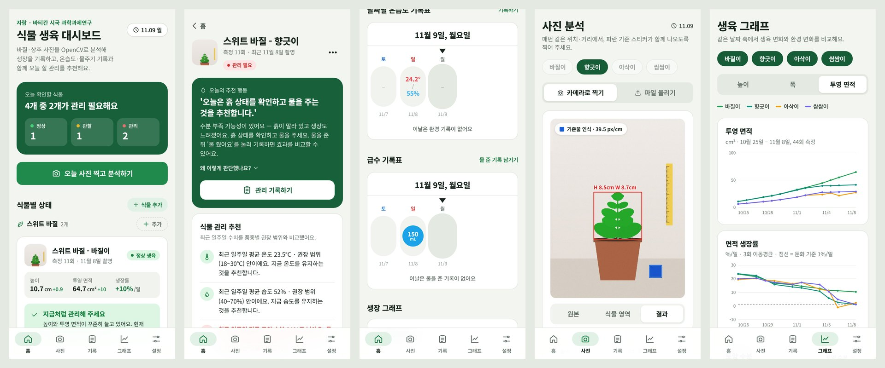

# 🌱 자람 — 식물 생장 기록 & 관리 추천 웹앱

> 2026 과학과제연구 「컴퓨터 비전 기반 식물 생육 분석 및 맞춤형 관리 추천 시스템」 (바티칸 시국)

휴대폰으로 식물 사진을 주기적으로 찍으면 **OpenCV로 높이·폭·투영 면적을 측정**하고, **지난 사진과 비교해 생장량과 생장률을 계산**합니다.
여기에 온도·습도·토양 수분·조도를 함께 기록하면 **규칙 기반 알고리즘이 식물 상태(정상 생육 / 관찰 필요 / 관리 필요)를 판단하고 물주기·광환경 확인 같은 관리 행동을 추천**합니다.



## 바로 실행하기

```bash
cd jaram
python -m pip install -r requirements.txt
python app.py
```

서버가 켜지면 이렇게 표시됩니다.

```
  🌱 자람 서버가 시작됐어요
     이 컴퓨터:  http://127.0.0.1:5000
     휴대폰:     http://192.168.0.12:5000  (같은 와이파이에 연결)
```

- **휴대폰**: 컴퓨터와 같은 와이파이에 연결한 뒤 `휴대폰:` 주소로 접속하세요. Safari/Chrome 메뉴에서 **홈 화면에 추가**를 누르면 앱처럼 쓸 수 있어요.
- **지난 사진을 겹쳐 보면서 찍기**(실시간 카메라)는 브라우저 보안 정책상 HTTPS에서만 됩니다. `python app.py --https`로 실행하고, 휴대폰에서 `https://…:5000`으로 접속한 뒤 인증서 경고에서 '계속'을 누르세요. HTTP로 접속해도 휴대폰 기본 카메라 앱으로 찍을 수 있어요.

### 데모 데이터로 먼저 둘러보기

실험 데이터가 쌓이기 전에 화면을 미리 보고 싶다면 합성 사진으로 만든 2주치 데모 데이터를 쓰세요. (실제 데이터와 섞이지 않도록 `data-demo` 폴더에 따로 만들어져요.)

```bash
python seed_demo.py
JARAM_DATA=data-demo python app.py          # macOS / Linux
set JARAM_DATA=data-demo && python app.py   # Windows
```

데모에는 계획서의 네 가지 상황이 들어 있어요: 바질 1 정상 생육, 바질 2 흙이 말라 생장 둔화(→ 물주기 추천), 상추 1 조도 부족으로 생장 둔화(→ 광환경 확인), 상추 2 고온이지만 생장 유지(→ 관찰).

## 주요 기능

| 화면 | 하는 일 |
|---|---|
| 홈 | 오늘 촬영 현황, 식물별 상태 배지와 최근 면적 변화, 해야 할 일 모아 보기 |
| 촬영 | 지난 사진을 반투명하게 겹쳐 같은 구도로 촬영(HTTPS) · 카메라 앱/앨범 선택 · 사진의 EXIF 촬영 시각 자동 인식 |
| 분석 결과 | 식물 영역·높이·폭 표시, 지난 기록 대비 변화, 환경값·직접 측정값·메모 입력 (같은 챔버의 최근 온도·습도·조도 자동 채움) |
| 식물 상세 | 상태와 추천 + **판단 근거(실제 수치)**, 생육 지표, 전후 비교 슬라이더(사진/분석 영역), 생장 그래프, 환경 타일, 기록 타임라인 |
| 크기 보정 | 사진 속 자의 두 눈금을 탭(돋보기 표시) → 1px = 몇 cm 인지 계산해 모든 값을 cm 단위로 표시 |
| 리포트 | 식물별 상대 생장 곡선 비교, 요약, **영상 분석 정확도**(자로 잰 값과 비교), CSV 내보내기 |
| 설정 | 라이트/다크/시스템 테마, **바질·상추별 추천 기준값 편집**, HSV 색상 범위, 모든 사진 다시 분석 |

## 계획서와 코드의 연결

| 계획서 | 코드 |
|---|---|
| 3-나-2) Python과 OpenCV 이미지 분석 (전처리 → HSV → Thresholding → Opening/Closing → Contour → 높이·폭·투영 면적) | `vision.py` |
| 2-파) 픽셀 → 실제 크기 환산 (기준물) | 크기 보정 화면 + `growth.with_units()` |
| 2-라) 변화량 `X₂ − X₁`, 생장률 `(X₂ − X₁) / (t₂ − t₁)` | `growth.py` |
| 3-다) 생육·환경 데이터 수집 | `db.py` (measurements, env_logs, care_logs) |
| 3-마) 규칙 기반 관리 추천 알고리즘 (IF → THEN) | `recommend.py` |
| 2-노) 상태 판단: 정상 생육 / 관찰 필요 / 관리 필요 가능성 | `recommend.evaluate()`의 `status` |
| 3-바) 피드백: 추천 → 사람이 행동 → 새 데이터로 결과 확인 | 추천의 '물 줬어요' 버튼 → 관리 기록 → 다음 측정에서 '효과를 지켜보는 중' |
| 3-아) 최종 검증: 영상 분석값 vs 수동 측정값 | 리포트 > 영상 분석 정확도, CSV |
| 3-차) 날짜·식물 ID 기준 통합 데이터셋 | 리포트/설정 > CSV 내보내기 (pandas로 바로 분석) |

### 추천 규칙 (요약)

| IF | THEN | 상태 |
|---|---|---|
| 토양 수분 < 기준 **그리고** 최근 생장률 감소 | 수분 부족 가능성 → 물주기 확인 | 관리 필요 |
| 토양 수분은 낮지만 높이·면적은 계속 증가 | 바로 판단하지 않고 관찰 | 관찰 필요 |
| 조도 < 기준이 지속 **그리고** 생장률 감소 | 광환경 부족 가능성 → 위치·조명 확인 | 관리 필요 |
| 온도·습도가 범위 밖으로 지속 **그리고** 생장 증가량 감소 | 환경 조건 확인 필요 | 관리 필요 |
| 토양 수분 > 기준이 지속 **그리고** 생장률 감소 | 과습 가능성 | 관리 필요 |
| 한 번에 투영 면적이 크게 감소 | 시듦 또는 촬영 오류 확인 | 관찰 필요 |
| 생장률이 줄었지만 환경으로 설명되지 않음 | 원인 불명 → 관찰 | 관찰 필요 |
| 특이 사항의 증상 조합 (예: 갈색 반점 + 겹무늬) | 의심 병해충 + 자료 기반 관리 방법 (환경·생장과 함께 판단) | 관찰/관리 필요 |
| 환경 안정 **그리고** 높이·면적 계속 증가 | 현재 관리 환경 유지 | 정상 생육 |

- **생장률 감소** = 최근 2구간의 면적 생장률(%/일)이 그 전 2구간보다 50% 이상 줄었거나, 하루 1% 미만(정체)
- **지속** = 최근 3번의 환경 기록 중 2번 이상 기준을 벗어남 (센서 값이 한 번 튀어서 잘못 추천하는 것을 막기 위함)
- 7일보다 오래된 환경 기록은 판단에 쓰지 않고, 토양 수분을 잰 뒤 물을 줬다면 그 값은 무시합니다.

### 특이 사항 규칙 (증상 → 병해충)

측정 기록의 **특이 사항**에 적은 글에서 먼저 **증상**을 찾고, 증상 조합으로 의심되는 병해충을 고릅니다. 사전은 `symptoms.py`에 있습니다.

1. **증상 키워드** — 이용자가 쓰는 말 → 증상 (띄어쓰기 무시, "반점 없음"처럼 부정하면 제외)

증상마다 **범위**가 있습니다. 넓은 말일수록 여러 병해충에 두루 나타나고, 좁은 말일수록 특정 병해충의 특징입니다.
좁은 증상은 상위 증상을 포함합니다(예: 암갈색 → 갈색 → 변색, 잿빛 곰팡이 → 곰팡이, 애벌레 → 벌레).

| 분류 | 넓음 | 중간 | 좁음 |
|---|---|---|---|
| 변색 | 색이 변함 | 노랗게, 갈색, 검게 | 연한 갈색(담갈색), 짙은 갈색(암갈색·고동색), 회백색 |
| 반점·무늬 | 반점·얼룩, 번짐·빠르게 커짐 | 작은 흰·노란 점(깨알) | 물에 젖은 듯한 병반(수침), 겹무늬(동심원), 가운데가 회색인 눈동자 모양 |
| 곰팡이·가루 | - | 곰팡이, 흰 곰팡이실(솜 같음), 그을음 | 흰 가루, 잿빛 곰팡이, 잎 뒷면 곰팡이, 검은 알갱이(균핵) |
| 조직 변화 | 썩음 | 물러짐, 상처 | 마른 채로 썩음, 악취, 잘록해짐 |
| 모양·생육 | - | 시듦·처짐, 말라 죽음, 오그라듦·말림, 쓰러짐, 웃자람 | - |
| 해충 흔적 | - | 벌레, 구멍·갉아 먹음 | 작은 벌레 무리, 먼지 같은 아주 작은 벌레, 애벌레, 배설물(똥), 알 덩어리, 구불구불한 흰 줄(굴), 점액 자국, 달팽이, 끈적임(감로), 거미줄 |
| 부위 | 밑동, 아래쪽 잎부터, 잎 뒷면, 새순·어린잎, 잎 끝·가장자리, 포기 전체 (다른 증상과 함께 있을 때만 씀) | | |

- 화면에는 가장 구체적인 증상만 보여 줍니다. ('연한 갈색'을 찾으면 '갈색'·'변색'은 따로 표시하지 않음)
- '흙이 말랐어요', '흙을 말리는 중', '새 잎이 났어요'처럼 증상이 아닌 글은 판단하지 않도록 '말라 죽음'·'잎 말림' 키워드는 잎·식물을 가리킬 때만 잡습니다.

2. **증상 → 병해충** — 병해충마다 증상별 점수를 더합니다. 대략 좁은 특징 증상 3~4점, 중간 1~2점, 넓은 증상 1점입니다.
- 넓은 증상(예: 변색 1점)을 적어 둔 병해충은 그 아래 구체적인 증상(노랗게·갈색 …)을 찾아도 그 점수를 받습니다.
- 같은 줄기(상위-하위)에서는 가장 구체적인 증상 하나만 점수에 넣어 중복으로 세지 않습니다. (암갈색을 찾으면 갈색무늬병은 '암갈색 2점'만, '갈색 1점'·'변색 1점'은 빼고 셈)

| 병해충 | 특징 증상 (좁음) | 함께 나타나는 증상 | 잘 생기는 환경 |
|---|---|---|---|
| 무름병 | 물러짐 3, 악취 3, 수침 병반 2 | 썩음 2, 밑동, 시듦, 상처, 포기 전체 | 과습·고습 |
| 잿빛곰팡이병 | 잿빛 곰팡이 4, 연한 갈색 2 | 수침 병반, 갈색, 곰팡이, 물러짐, 오그라듦, 썩음, 균핵, 잎 끝, 번짐 | 고습·과습 |
| 갈색무늬병 | 겹무늬 4, 눈동자 모양 3, 암갈색 2 | 수침 병반, 반점, 아래쪽 잎, 노랗게, 말라 죽음, 번짐 | - |
| 밑둥썩음병 | 마른 채로 썩음 3, 밑동 2, 암갈색 2 | 썩음 2, 반점, 말라 죽음, 포기 전체 | 과습 |
| 균핵병 | 검은 알갱이(균핵) 4, 흰 곰팡이실 2, 연한 갈색 2 | 곰팡이, 밑동, 물러짐, 썩음, 포기 전체 | 고습·저온 |
| 흰가루병 | 흰 가루 4, 회백색 2 | 곰팡이, 노랗게, 말라 죽음 | 일조 부족 |
| 노균병 | 잎 뒷면 곰팡이 4 | 흰 곰팡이실, 잎 뒷면, 노랗게, 반점, 아래쪽 잎, 갈색 | 고습·저온·과습 |
| 모잘록병 | 잘록해짐 3, 밑동 2 | 물러짐, 쓰러짐 | 과습·고습·저온 |
| 쓰러짐(원인 미확정) | 쓰러짐 2 | → 빛 부족(웃자람)·수분 스트레스·물리적 상처 중 원인을 좁힘 | - |
| 진딧물 | 작은 벌레 무리 4, 끈적임 3, 그을음 2 | 벌레, 오그라듦, 새순, 잎 뒷면 | - |
| 응애 | 거미줄 4, 먼지 같은 작은 벌레 3, 작은 점 2 | 벌레, 잎 뒷면, 노랗게, 말라 죽음 | 고온·건조 |
| 아메리카잎굴파리 | 구불구불한 흰 줄 4 | 작은 점, 벌레, 갈색, 반점, 말라 죽음 | 고온 |
| 나방 애벌레 | 애벌레 4, 배설물 3, 알 덩어리 2 | 구멍 2, 벌레, 새순 | - |
| 달팽이류 | 달팽이 4, 점액 자국 3 | 구멍, 알 덩어리 | 고습·과습 |

3. **판단**
- 증상 점수 2점 이상이면 후보입니다. 순위를 정할 때 잘 생기는 환경이 기록으로 확인되면 +1, 그 작물 자료에 있는 병해충이면 +1을 더합니다.
- **관리 필요**: 증상 점수 5점 이상, 또는 3점 이상이면서 잘 생기는 환경이나 생장 둔화가 함께 확인될 때. 그 밖에는 **관찰 필요**입니다.
- 글에서 찾은 같은 증상으로 의심되는 후보는 한 추천에 묶고, 1위와 2점 차이 안의 후보만 "○○ 또는 △△ 의심"으로 함께 보여 주며 **구분하는 특징**을 안내합니다. 증상이 겹치지 않는 문제는 따로 추천합니다.
- '변색', '반점', '곰팡이', '벌레'처럼 넓거나 중간 범위의 증상 하나뿐이라 후보가 없으면 **관련 병해충과 구분 방법**을 안내합니다(관찰 필요).
- 병해충 이름을 직접 적어도(예: 진딧물) 인식합니다. 더 최근 기록에 '이상 없음', '반점 없어짐'처럼 적으면 해결된 것으로 봅니다.
- 조치(잎 정리·격리·벌레 잡기)를 기록하면 '조치 후 지켜보는 중'으로 바뀝니다. 최근 7일 기록과 가장 최근 기록의 특이 사항만 봅니다.
- 출처: 농사로 작목별 병해충(상추 11종 상세 정보), 제공 자료(모종 쓰러짐, 상추 노균병·진딧물, 허브 흰가루병·응애)
- 사전은 개발자만 `symptoms.py`에서 바꿀 수 있고, 앱의 **설정 > 특이 사항 키워드**에서 확인할 수 있어요.

### 기준값을 실험 데이터로 바꾸기

관리 행동 추천 규칙에 쓰는 숫자(온도·습도·토양 수분 범위, 조도 최솟값, 둔화·정체·급감 기준, 잎 색 변화, 물주기 간격, 공통 판단 기준)와 특이 사항 키워드는 **개발자만** `thresholds.py` / `symptoms.py`에서 바꿀 수 있어요.
앱 이용자는 **설정 > 추천 기준**에서 값을 확인만 할 수 있고, 서버도 이 값을 바꾸는 요청을 거부해요(403).
처음 값은 일반적인 재배 정보 기반 **초기값**이고, 계획서 4단계처럼 1단계에서 모은 바질·상추 데이터를 보고 `thresholds.py`를 고친 뒤 서버를 다시 시작하면 됩니다.

추천 규칙이 아닌 **식물 영역 색상(HSV) 범위**(사진 분석 설정)는 원래처럼 앱의 각 식물 기준 화면에서 바꾸고 기본값으로 되돌릴 수 있어요.
색상 범위를 바꿨다면 '모든 사진 다시 분석'을 눌러 이전 사진에도 새 범위를 적용하세요.

## 폴더 구조

```
jaram/
├── app.py            Flask 서버 + JSON API
├── vision.py         OpenCV 식물 영역 분석
├── growth.py         변화량·생장률 계산
├── recommend.py      규칙 기반 상태 판단·추천
├── thresholds.py     추천 기준 초기값
├── symptoms.py       특이 사항 증상 키워드 → 병해충 연결 사전
├── db.py             SQLite 저장
├── seed_demo.py      데모 데이터(합성 사진) 생성
├── static/           모바일 웹 화면 (HTML·CSS·JS, 빌드 과정 없음)
│   ├── css/app.css   디자인 시스템 (라이트/다크 색상 토큰)
│   └── js/           화면(views), 차트, 카메라, API
├── tests/            pytest 테스트
└── data/             ← 실행하면 생김: jaram.db + uploads/(사진). 깃에 올라가지 않으니 따로 백업하세요.
```

## 테스트

```bash
python -m pytest
```

이미지 분석(자·화분 제외, 해상도가 달라도 같은 값), 생장률 공식, 각 추천 규칙, API 전체 흐름을 검사합니다.

## 참고

- 사진은 긴 변 1280px로 맞춘 뒤 분석해서, 같은 위치에서 찍으면 사진마다 1픽셀이 같은 실제 길이가 되도록 했어요.
- 사진 파일 이름은 `식물ID_날짜-시각_xxxx.jpg` 형식이에요 (계획서: 파일명에 식물 ID와 촬영 날짜 기록).
- 같은 와이파이의 누구나 접속할 수 있으니 학교·집 네트워크에서만 사용하세요.
- 추천은 식물 상태를 의학적·생물학적으로 진단하는 것이 아니라, 측정 데이터로 관리 행동을 정할 때 참고하는 보조 정보예요.
