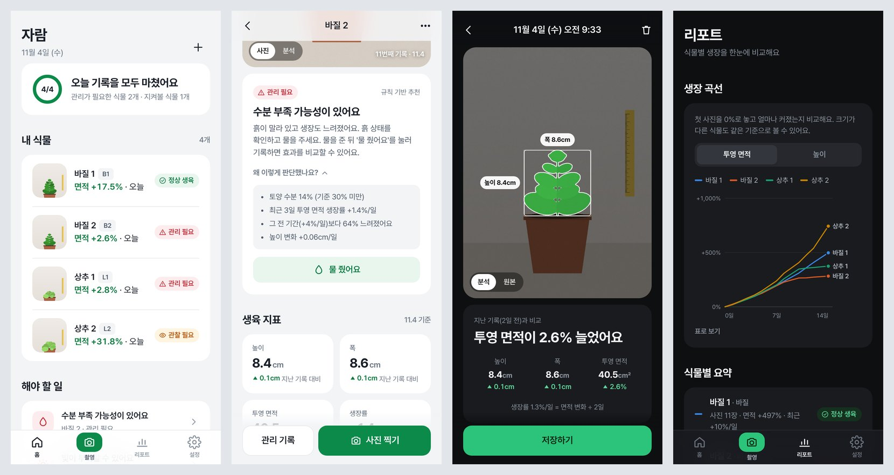

# 🌱 자람 — 식물 생장 기록 & 관리 추천 웹앱

> 2026 과학과제연구 「컴퓨터 비전 기반 식물 생육 분석 및 맞춤형 관리 추천 시스템」 (바티칸 시국)

휴대폰으로 식물 사진을 주기적으로 찍으면 **OpenCV로 높이·폭·투영 면적을 측정**하고, **지난 사진과 비교해 생장량과 생장률을 계산**합니다.
여기에 온도·습도·토양 수분·조도를 함께 기록하면 **규칙 기반 알고리즘이 식물 상태(정상 생육 / 관찰 필요 / 관리 필요)를 판단하고 물주기·광환경 확인 같은 관리 행동을 추천**합니다.
식물 둘레를 돌며 여러 각도로 찍으면 **3D 영역(부피)까지 계산**해 잎이 앞뒤로 자라는 변화도 잡고, 모은 실험 데이터로 **기준값을 제안**받고 **추천을 따랐을 때 효과가 있었는지 검증**할 수 있어요.

> 알고리즘의 모든 단계·수식·기준값은 [ALGORITHM.md](ALGORITHM.md)에 정리돼 있어요.



## 바로 실행하기

```bash
cd jaram
python -m pip install -r requirements.txt
python app.py
```

서버가 켜지면 이렇게 표시됩니다.

```
  🌱 자람 서버가 시작됐어요
     이 컴퓨터:  http://127.0.0.1:5000
     휴대폰:     http://192.168.0.12:5000  (같은 와이파이에 연결)
```

- **휴대폰**: 컴퓨터와 같은 와이파이에 연결한 뒤 `휴대폰:` 주소로 접속하세요. Safari/Chrome 메뉴에서 **홈 화면에 추가**를 누르면 앱처럼 쓸 수 있어요.
- **지난 사진을 겹쳐 보면서 찍기**(실시간 카메라)는 브라우저 보안 정책상 HTTPS에서만 됩니다. `python app.py --https`로 실행하고, 휴대폰에서 `https://…:5000`으로 접속한 뒤 인증서 경고에서 '계속'을 누르세요. HTTP로 접속해도 휴대폰 기본 카메라 앱으로 찍을 수 있어요.

### 인터넷에 배포하기 (어디서나 접속)

[DEPLOY.md](DEPLOY.md)에 PythonAnywhere(무료)에 올리는 방법을 단계별로 정리했어요. 배포하면 `https://아이디.pythonanywhere.com` 주소로 와이파이와 상관없이 접속하고, 실시간 카메라도 바로 쓸 수 있어요.
인터넷에 올릴 때는 **팀 비밀번호**(`JARAM_PASSWORD`)를 꼭 설정하세요. 설정하면 처음 접속할 때 로그인 화면이 나와요.

```bash
JARAM_PASSWORD=팀비밀번호 python app.py     # 집·학교 와이파이에서도 비밀번호를 걸고 싶을 때
```

### 데모 데이터로 먼저 둘러보기

실험 데이터가 쌓이기 전에 화면을 미리 보고 싶다면 합성 사진으로 만든 2주치 데모 데이터를 쓰세요. (실제 데이터와 섞이지 않도록 `data-demo` 폴더에 따로 만들어져요.)

```bash
python seed_demo.py
JARAM_DATA=data-demo python app.py          # macOS / Linux
set JARAM_DATA=data-demo && python app.py   # Windows
```

데모에는 계획서의 네 가지 상황이 들어 있어요: 바질 1 정상 생육(10일째 흙이 말랐다가 물주기 추천을 따른 뒤 회복), 바질 2 흙이 말라 생장 둔화(→ 물주기 추천), 상추 1 조도 부족으로 생장 둔화(→ 광환경 확인), 상추 2 고온이지만 생장 유지(→ 관찰).
식물마다 0·7·14일에 3D 측정(측면 4장 + 위 1장)도 들어 있어요.

## 주요 기능

| 화면 | 하는 일 |
|---|---|
| 홈 | 오늘 촬영 현황, 식물별 상태 배지와 최근 면적 변화, 해야 할 일 모아 보기 |
| 촬영 | 지난 사진을 반투명하게 겹쳐 같은 구도로 촬영(HTTPS) · 카메라 앱/앨범 선택 · 사진의 EXIF 촬영 시각 자동 인식 |
| 분석 결과 | 식물 영역·높이·폭 표시, 지난 기록 대비 변화, 환경값·직접 측정값·메모 입력 (같은 챔버의 최근 온도·습도·조도 자동 채움) |
| 식물 상세 | 상태와 추천 + **판단 근거(실제 수치)**, 생육 지표, 전후 비교 슬라이더(사진/분석 영역), 생장 그래프, 환경 타일, 기록 타임라인 |
| 크기 보정 | 사진 속 자의 두 눈금을 탭(돋보기 표시) → 1px = 몇 cm 인지 계산해 모든 값을 cm 단위로 표시 |
| 분석 영역 지정 | 사진에서 이 식물이 있는 곳만 사각형으로 지정 → 옆 화분 잎·초록 소품을 분석에서 제외, 지난 사진도 다시 분석 |
| **3D 측정** | 0°(평소 자리)·90°·180°·270° + 위(선택)를 차례로 촬영(촬영 위치 그림·수평계·지난 사진 겹쳐 보기) → **시각 헐로 3D 부피·높이·폭·깊이** 계산, 끌어서 돌려 보는 3D 미리보기, 지난 측정 대비 부피 변화 |
| 리포트 | 식물별 상대 생장 곡선·**3D 부피 곡선** 비교, 요약, **추천 효과 검증**, **영상 분석 정확도**(자로 잰 값과 비교), CSV 내보내기 |
| 추천 효과 검증 | 지난 기록으로 그때 나왔을 추천을 다시 계산 → 추천을 따랐을 때와 안 따랐을 때 다음 측정의 생장률·회복 비율·토양 수분 비교 |
| 설정 | 라이트/다크/시스템 테마, **바질·상추별 추천 기준값 편집**, **실험 데이터로 기준 제안받기**, HSV 색상 범위, 모든 사진 다시 분석, CSV·전체 백업(zip) 받기, 알고리즘 설명 |
| 로그인 | 서버에 팀 비밀번호를 설정하면 처음 한 번 로그인 (휴대폰마다 180일 유지) |

## 계획서와 코드의 연결

| 계획서 | 코드 |
|---|---|
| 3-나-2) Python과 OpenCV 이미지 분석 (전처리 → HSV → Thresholding → Opening/Closing → Contour → 높이·폭·투영 면적) | `vision.py` |
| 2-파) 픽셀 → 실제 크기 환산 (기준물) | 크기 보정 화면 + `growth.with_units()` |
| 2-라) 변화량 `X₂ − X₁`, 생장률 `(X₂ − X₁) / (t₂ − t₁)` | `growth.py` |
| 3-다) 생육·환경 데이터 수집 | `db.py` (measurements, env_logs, care_logs) |
| 3-마) 규칙 기반 관리 추천 알고리즘 (IF → THEN) | `recommend.py` |
| 2-노) 상태 판단: 정상 생육 / 관찰 필요 / 관리 필요 가능성 | `recommend.evaluate()`의 `status` |
| 3-바) 피드백: 추천 → 사람이 행동 → 새 데이터로 결과 확인 | 추천의 '물 줬어요' 버튼 → 관리 기록 → 다음 측정에서 '효과를 지켜보는 중' |
| 3-아) 최종 검증: 영상 분석값 vs 수동 측정값 | 리포트 > 영상 분석 정확도, CSV |
| 3-차) 날짜·식물 ID 기준 통합 데이터셋 | 리포트/설정 > CSV 내보내기 (pandas로 바로 분석) |
| 4단계) 실험 데이터로 기준값 설정 | 설정 > 종류별 기준 > 실험 데이터로 기준 제안받기 (`suggest.py`) |
| 7단계) 추천 효과 검증 | 리포트 > 추천 효과 검증 (`validation.py`) |
| (추가) 투영 면적의 한계 보완: 여러 각도 3D 분석 | 3D 측정 (`vision3d.py`, `scans_api.py`) |

### 추천 규칙 (요약)

| IF | THEN | 상태 |
|---|---|---|
| 토양 수분 < 기준 **그리고** 최근 생장률 감소 | 수분 부족 가능성 → 물주기 확인 | 관리 필요 |
| 토양 수분은 낮지만 높이·면적은 계속 증가 | 바로 판단하지 않고 관찰 | 관찰 필요 |
| 조도 < 기준이 지속 **그리고** 생장률 감소 | 광환경 부족 가능성 → 위치·조명 확인 | 관리 필요 |
| 온도·습도가 범위 밖으로 지속 **그리고** 생장 증가량 감소 | 환경 조건 확인 필요 | 관리 필요 |
| 토양 수분 > 기준이 지속 **그리고** 생장률 감소 | 과습 가능성 | 관리 필요 |
| 한 번에 투영 면적이 크게 감소 | 시듦 또는 촬영 오류 확인 | 관찰 필요 |
| 생장률이 줄었지만 환경으로 설명되지 않음 | 원인 불명 → 관찰 | 관찰 필요 |
| 잎 평균 색이 처음보다 노란 쪽으로 변함 | 조명 조건·과습·빛·양분 확인 | 관찰 필요 |
| 정면 사진과 3D 측정의 판단이 엇갈림 | 촬영 각도·높이 확인 (3D 우선) | 관찰 필요 |
| 환경 안정 **그리고** 높이·면적 계속 증가 | 현재 관리 환경 유지 | 정상 생육 |

- **생장률 감소** = 최근 2구간의 면적 생장률(%/일)이 그 전 2구간보다 50% 이상 줄었거나, 하루 1% 미만(정체)
- **3D 우선** = 최근 3D 측정이 2번 이상 있고(마지막이 7일 안, 최근 사진 구간과 겹침) 그 부피 생장률(하루 평균 복리)로 생장 감소·잘 자람을 판단, 정면 사진은 보조 근거
- **지속** = 최근 3번의 환경 기록 중 2번 이상 기준을 벗어남 (센서 값이 한 번 튀어서 잘못 추천하는 것을 막기 위함)
- 7일보다 오래된 환경 기록은 판단에 쓰지 않고, 토양 수분을 잰 뒤 물을 줬다면 그 값은 무시합니다.

### 기준값을 실험 데이터로 바꾸기

모든 숫자(온도·습도·토양 수분 범위, 조도 최솟값, 둔화·정체·급감 기준, HSV 범위 등)는 **앱의 설정 > 추천 기준**에서 바로 바꿀 수 있어요.
처음 값은 `thresholds.py`에 있는 일반적인 재배 정보 기반 **초기값**이고, 계획서 4단계처럼 1단계에서 모은 바질·상추 데이터를 보고 조정하면 됩니다.
**실험 데이터로 기준 제안받기**를 누르면 기간을 정해 통계(정상 구간 생장률 하위 10%, 물 주기 직전 토양 수분 중앙값 등)로 계산한 제안값과 근거를 보여 주고, 고른 항목만 입력칸에 채워 줘요.
색상(HSV) 범위를 바꿨다면 '모든 사진 다시 분석'을 눌러 이전 사진에도 새 범위를 적용하세요.

## 폴더 구조

```
jaram/
├── app.py            Flask 서버 + JSON API + 팀 비밀번호 로그인
├── wsgi.py           배포 서버용 진입점
├── DEPLOY.md         배포 안내 (PythonAnywhere)
├── ALGORITHM.md      알고리즘 명세서 (수식·기준값·검증 방법)
├── vision.py         OpenCV 식물 영역 분석 (+ 분석 영역)
├── vision3d.py       여러 각도 사진 → 3D 시각 헐 (부피)
├── scans_api.py      3D 측정 API
├── growth.py         변화량·생장률·부피 생장률 계산
├── recommend.py      규칙 기반 상태 판단·추천 (2D + 3D)
├── thresholds.py     추천 기준 초기값
├── suggest.py        실험 데이터로 기준값 제안
├── validation.py     추천 효과 검증
├── db.py             SQLite 저장 (+ 기존 DB 자동 마이그레이션)
├── seed_demo.py      데모 데이터(합성 사진) 생성
├── static/           모바일 웹 화면 (HTML·CSS·JS, 빌드 과정 없음)
│   ├── css/app.css   디자인 시스템 (라이트/다크 색상 토큰)
│   └── js/           화면(views), 차트, 카메라, API
├── design/figma/     Figma 플러그인: 앱 화면을 오토레이아웃 디자인으로 만들기 (README 참고)
├── tests/            pytest 테스트
└── data/             ← 실행하면 생김: jaram.db + uploads/(사진). 깃에 올라가지 않으니 따로 백업하세요.
```

## 테스트

```bash
python -m pytest
```

이미지 분석(자·화분 제외, 해상도가 달라도 같은 값, 분석 영역), 3D 부피(이론 부피를 아는 도형 대비 오차·손촬영 보정·위 사진 방향), 생장률 공식, 각 추천 규칙(3D 우선·불일치 포함), 기준값 제안 통계, 추천 효과 검증, API 전체 흐름, 로그인·백업·옛 DB 마이그레이션을 검사합니다.

## 참고

- 사진은 긴 변 1280px로 맞춘 뒤 분석해서, 같은 위치에서 찍으면 사진마다 1픽셀이 같은 실제 길이가 되도록 했어요.
- 사진 파일 이름은 `식물ID_날짜-시각_xxxx.jpg` 형식이에요 (계획서: 파일명에 식물 ID와 촬영 날짜 기록).
- 비밀번호 없이 실행하면 같은 와이파이의 누구나 접속할 수 있어요. 인터넷에 올릴 때는 반드시 `JARAM_PASSWORD`를 설정하세요.
- 추천은 식물 상태를 의학적·생물학적으로 진단하는 것이 아니라, 측정 데이터로 관리 행동을 정할 때 참고하는 보조 정보예요.
